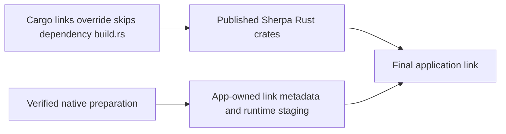

# Sherpa build integration without a library fork

Status: **production integration candidate; qualification pending**, November 15,
2026. The owner accepted the bounded proof and authorized this integration after
Stage 3b smokes passed. Cargo now uses unchanged registry bindings; the unused
vendor reference stays until native platform gates pass. No 7M models are added.
Checkpoint: `a5f3d862f99b1f81b51f8329dddace74526e2fef` on `task/sherpa-onnx`.
The owner reports Stage 3c.2 smokes pass. `PAPERCUT.md` remains excluded.
Other native-platform tests are deferred by the owner until PR preparation;
qualification and vendor retirement remain PR/merge gates. The owner explicitly
allows paired English/Arabic 7M work after local acceptance, before those deferred
tests; this changes scheduling, not the required platform or speech-quality gates.

## Security patch pass — November 15

The smoke-passed TTS integration was checkpointed separately before these updates:

| Package | Before | After | Advisory |
| --- | --- | --- | --- |
| ammonia | 4.2.4 | 4.2.5 | RUSTSEC-2026-0533 |
| quinn-proto | 0.11.18 | 0.11.19 | RUSTSEC-2026-0523, RUSTSEC-2026-0524 |
| quinn-udp | 0.5.14 | 0.5.16 | RUSTSEC-2026-0538 |

The manifest raises Ammonia's minimum to 4.2.5; Quinn stays transitive in the lock.
Only these three versions/checksums change. Cargo's initial update also rewrote
unrelated dependency references; existing compatible references were preserved
and validated with `cargo metadata --locked`. No package additions, broad update,
new override, upstream source modification or new audit waiver is introduced.

The primary RustSec records and downloaded crate sources identify these as the
patched releases: [Ammonia](https://rustsec.org/advisories/RUSTSEC-2026-0533),
[Quinn stream limits](https://rustsec.org/advisories/RUSTSEC-2026-0523),
[Quinn Retry tokens](https://rustsec.org/advisories/RUSTSEC-2026-0524), and
[Quinn UDP receive handling](https://rustsec.org/advisories/RUSTSEC-2026-0538).
The existing reader sanitizer policy remains unchanged; it already excludes the
raw-text gadget tags described by the Ammonia advisory. No Quinn reverse dependency
appears in the checked host native/provider normal graph; fixing its lock entries
does not enable HTTP/3 or imply that a reachable QUIC exploit was reproduced.

Local validation: CI-pinned cargo-audit 0.22.2 passes with the same two existing
waivers and 12 warning-only findings; no new waiver. Native/provider tests pass
364/10 ignored; default tests pass 293/4 ignored, including reader sanitization,
HTML/EPUB/bundle handling and loopback network cases. Notices are regenerated and
checked; source assembly and the inventory lock hash are refreshed. Evidence:
`.cache/sherpa-security-2026-11-15/`. These checks do not execute QUIC protocol
regressions or prove the deferred native platforms.

Reviewer gates for this pass:

- [ ] Review the three-crate-only lock delta and unchanged audit waivers.
- [ ] Smoke an HTML/EPUB import, reader text/images/footnotes and an existing
  audiobook's playback/import/export; confirm normal content remains usable.
- [ ] Accept local security work, then start paired 7M qualification. Native
  Windows/macOS/iOS, installed-app/minimum-OS and device evidence remains required
  at PR/merge time. Keep the inactive vendor reference until that qualification.

Suggested security commit: `fix(deps): patch sanitizer and QUIC audit findings`

> Update Ammonia to 4.2.5, quinn-proto to 0.11.19 and quinn-udp to 0.5.16 without
> changing other package versions or dependency references. Refresh notices/source
> inventory and record owner smoke acceptance and PR-time platform gates. Audit
> and existing native/default regressions pass; no new waiver or application logic.

## Production integration — November 15 (checkpoint evidence)

The active `[patch.crates-io]` entry is removed. Root `.cargo/config.toml` supplies
target links overrides; `src-tauri/build/sherpa.rs` selects the existing native
link modes. `build/native.rs` consolidates archive verification/repair and runtime
staging with Piper, using app-owned `tts/native-artifacts.json` and the existing
Piper pins. No published binding or upstream C/C++ implementation is modified.
The dormant vendor files are not a dependency and are retained only until the
native-platform gates permit retirement.

The app still prepares desktop archives automatically on a cold direct Cargo
build. Receipts bind extracted file hashes to the reviewed archive hash; empty,
changed, additional or partially extracted files invalidate reuse. Source library,
receipt and pin changes trigger relinking/restaging. Watching staged outputs is
avoided. Cargo can need one settling rebuild after a repair modifies inputs during
a build; subsequent unchanged runs are fresh. Piper's `lib/` archive layout and
Windows `bin/` DLL layout remain supported. Required import libraries and runtime
DLLs are checked before linking. Versioned SONAME siblings survive library aliases,
including aliases whose targets are outside lib/. Unix keeps atomic inode replacement; only Windows
stages adjacent test DLLs, preserving the single-ORT policy.

Cargo derives cache roots from its actual OUT_DIR, including custom target paths
and cross builds. Official Node helpers follow `CARGO_TARGET_DIR` and explicit
native overrides; use that environment variable for a custom desktop bundle root.
Normal wrappers run inside the checkout. External Cargo callers must explicitly
load root `.cargo/config.toml`, as the owner agreed. No promise is made for arbitrary
outside-directory manifest calls without that config. macOS Tauri minimum and
Cargo deployment default now both declare **15.0**; minimum-OS execution is pending.

Current-pass evidence is separate from the frozen isolated proof below:
`.cache/sherpa-stage3c-integration-2026-11-15/`.

| Current check | Result and limit |
| --- | --- |
| Actual app suites | 364 native/provider tests pass (10 ignored); 293 default tests pass (4 ignored); four build-plumbing regressions pass |
| Scripts | 65 tests pass; changed JavaScript lint and Rust build-module formatting checked separately |
| Speech | All 18 current-roster frontend cases pass in shared and static builds. Pinned Kokoro weights were fetched into a private cache because the old test symlink was dangling. This is not a new human listening verdict. |
| Embeddings/runtime loading | Actual app E5 Small FP32 lifecycle/index/query passes. A current-source isolated harness exercises real Kokoro/Kareem/Libtashkeel/E5 in both initialization orders with one ORT. Profile copies with private native inputs visible and hidden pass both orders, paths with spaces and no loader overrides. No owner library is changed. |
| Cold and repaired caches | Production build modules download verified archives and run inference with a custom output path containing spaces. Warm unchanged builds are fresh; changed Sherpa/Piper libraries repair, restage and relink; no continuing rebuild loop. Offline deterministic tests cover stale/missing receipts, empty/extra files, corrupt archives and both layouts. |
| Linux Tauri | Actual debug `--no-bundle` build passes via nested Cargo; native-only config reuses the existing frontend distribution. No installer/install/launch claim. |
| Android | Actual Node wrapper/Tauri/Gradle/Cargo arm64 debug APK builds. Final native ABI/alignment/notices checks are recorded in the packet; debug artifacts do not satisfy publication/signature/device gates. |
| Desktop target metadata | Eight checks pass with actual pinned Windows x64, Intel/ARM macOS and Linux ARM shared/static archives, exercising their real preparation/layouts. No native SDK/link/runtime claim. |
| Mobile target routing | Three iOS Rust metadata checks use empty ar sentinels from nested `gen/apple`; they are not Xcode/SDK/native builds. Android x64 additionally cross-links against the source-built inputs; it is not executed. |
| Notices/source | Regenerated notices include the resolved registry build-dependency candidates; corresponding-source assembly passes locally. This is not a release-tag/publication acceptance. |
| Dependency delta | 27 added resolved package identities, including registry sys; no existing package version replaced. The sys build script is skipped. Artifact inspection finds new `jobserver 0.1.35` in shared host build tooling via `cc`; other added transitive packages have no compiled unit. The app ZIP backend stays unchanged. |
| Audit | **Fails:** four vulnerabilities also present in the exact pre-pass lockfile. Same CI-pinned cargo-audit 0.22.2/database/existing waivers; no new finding or waiver. |

Qualification caught another loader edge: the earlier cache-first rpath order
could load a second ORT when an executable had adjacent runtime copies while its
build cache remained accessible. The single-ORT assertion reproduced the failure;
the failing log is retained. Installed resources and adjacent runtimes now precede
absolute cache fallbacks. Both initialization orders pass in relocated/profile
layouts with the private cache visible and hidden. This fix changes application
link metadata, not library implementation, model files or synthesis provenance.

The audit findings are ammonia 4.2.4 (`RUSTSEC-2026-0533`), quinn-proto 0.11.18
(`RUSTSEC-2026-0523`, `RUSTSEC-2026-0524`) and quinn-udp 0.5.14
(`RUSTSEC-2026-0538`). Resolve them in a separate minimal patch pass before merge;
this build migration does not waive the failed audit gate. Existing warning-only
findings remain reported by the audit tool. Baseline and candidate logs are saved.

Human gates remaining for this candidate:

- [ ] Review preparation/link/staging ownership and the registry dependency identity.
- [x] Owner reports the requested Stage 3c.2 smoke tests pass (November 15):
  app launch, Kokoro/Kareem previews, Arabic preprocessing, existing book
  playback/export and save/cancel/reopen smokes. With embeddings enabled, query
  while speech is usable. This build-only change must not reset compatible
  2.0.1 partials; model IDs and synthesis provenance are unchanged.
- [x] Resolve the four baseline audit vulnerabilities with the separate three-crate
  security pass above; existing warning-only findings and two waivers are unchanged.
- [ ] Accept real Windows MSVC, Intel/Apple Silicon macOS and iOS SDK builds,
  installed-app loading, macOS 15 minimum execution and Android inference. No
  remote CI workflow has been dispatched by this pass.
- [ ] Retire the dormant tracked vendor crate only after its replacement passes
  those platform gates. Keep the excluded local `PAPERCUT.md` out of commits.
- [x] Owner allows paired English Kokoro 7M / Arabic Nabra 7M work after local
  acceptance; deferred native qualification stays a PR/merge gate.

Checkpoint commit `a5f3d86` (Stage 3b + 3c after `31fa781f`): `feat(tts): upgrade Sherpa with registry-based native builds`

Description: Upgrade the existing roster to exact Sherpa 2.0.1 with app-owned
Piper 1.5.9 phonemization and unchanged published Rust bindings. Replace the sys
Cargo patch with target links overrides; consolidate pinned native preparation,
platform linking and safe single-ORT runtime staging. Preserve model identities,
languages, voices and completed audio; advance engine provenance for explicit
restart of incompatible older partials. Align macOS metadata to 15.0 and update
packaging, CI, notices and handoff gates. Retain the unused vendor reference until
native qualification passes. Local checks pass within the stated scopes; four
baseline audit findings and SDK/device gates remain open.

The engine/provenance changes in that description belong to the Stage 3b
portion of the checkpoint. Stage 3c's build-only changes do not advance the 2.0.1 synthesis
revision again or reset compatible 2.0.1 partials.

## Historical bounded proof (Stage 3c.1)

The sections below describe the earlier isolated proof, not additional current-pass
platform execution. Its original evidence packet remains frozen.

## Decision and mechanism

The bounded proof recommended replacing the local Rust sys package with unchanged registry
`sherpa-onnx`/`sherpa-onnx-sys` 2.0.1 packages, after the integration gates below.
Keep native preparation, checks and packaging application-owned. This removes a
library-source rebase responsibility; native integration still needs maintenance.

Cargo's supported [links build-script override](https://doc.rust-lang.org/cargo/reference/build-scripts.html#overriding-build-scripts)
can suppress the dependency's build script while keeping its published bindings.
The dependency declares `links = "sherpa-onnx"`. The prototype uses, for example:

```toml
[target.x86_64-unknown-linux-gnu.sherpa-onnx]
rustc-link-lib = []
```

The application build script selects shared/static libraries using its existing
features and target OS. This avoids generating conflicting per-feature global
Cargo configurations. The prototype provides overrides for Linux x64/ARM64,
macOS Intel/Apple Silicon, Windows x64 MSVC, Android arm64/x64, and iOS device and
simulator targets. Target presence is not proof of native execution on that OS.



The isolated export contains no vendor directory or Cargo patch. Its production
synthesis/model/save code is unchanged. A test-only harness connects existing
speech, Libtashkeel and embedding checks to exercise their shared runtime.

## Why the patch existed

Git history records concrete integration fixes:

- `ef79f5f7`, July 4: iOS thin aggregate static archives and simulator/device paths.
- `6a1362d1`, October 7: atomic replacement of mapped Unix native libraries.
- `4feb9953`, October 10: Windows runtime DLL placement beside test executables.
- November: restored/empty native-cache validation; Stage 3b updates pins/link inputs.

All 15 current sys binding files match upstream 2.0.1. The custom surface is the
Rust build/packaging adapter, atomic-copy helper and archive pins. No Sherpa,
Piper, eSpeak or ORT C/C++ implementation is patched. History explains the
immediate fixes, but does not establish that a library fork was necessary.

Pinned upstream 2.0.1 selects shared mode on iOS even with its static feature and
uses a desktop component list for static linking. A library-directory override
alone therefore cannot preserve our iOS aggregate-static path. The Cargo override
bypasses that build behavior while leaving upstream Rust source intact.

## What was actually proved

Evidence is local and ignored under `.cache/sherpa-fork-free-proof-2026-11-15/`.
The packet includes the exported app, exact lockfiles/configuration, focused
integration/test patches, commands/scripts, logs, results and checksums. Public
cached models are read-only test inputs; no owner book/library is modified.

| Check | Observed result and limit |
| --- | --- |
| Registry identity | Published sys 2.0.1, checksum `5bc46e5fb3aab39141d48ad8763d0891e0b9e0fbc8e3bdefaa63704d1bf00054`; no vendor/Cargo patch in export; dependency build script not compiled/run |
| Full Linux app native suite, shared + preprocessing + embeddings | 364 passed; 11 ignored, including the new isolated opt-in coexistence harness |
| Full app frontend corpus | All 18 cases pass in shared and static variants, with finite/non-silent audio; existing languages and US/British/speaker mappings retained. Structural proof, not a new human listening verdict. |
| Real shared runtime coexistence | Actual Kokoro frontend, Kareem + Libtashkeel, and E5 Small FP32 lifecycle/index/query pass speech-first and embeddings-first; one ORT image in process maps |
| Linux Tauri CLI | Actual debug application builds through nested Cargo with automatic ancestor-config discovery; no app launched, no installer produced |
| Android wrapper/Tauri/Gradle/Cargo | Isolated arm64 debug APK builds without a library patch. Native ABI/16 KB alignment/notices and Sherpa/Piper/AAR ORT byte equality verified; only one ORT packaged. No device execution or production signing. |
| Android x86_64 and arm64 probes | Actual cross-links against pinned source-built libraries; no emulator/device runtime claim |
| Apple/Windows targets | Nine Rust/config/link-metadata checks pass: iOS arm64 device, arm64/x64 simulators; macOS x64/arm64 shared/static; Windows x64 MSVC shared/static. Empty native sentinel inputs make these explicitly **not** SDK/native-link/runtime tests. |
| Linux ARM64 | Shared/static Rust metadata checks pass; no native linking, ARM execution or installer claim |
| Relocation | Full app test executable and matching runtime moved to a path with spaces; original proof native-input path hidden; no LD_LIBRARY_PATH/ORT_DYLIB_PATH. Real coexistence passes both orders with one relocated ORT image. |
| Cargo path handling | Actual Linux inference with custom target and native-input paths containing spaces; automatic config discovery from nested `gen/apple`; explicit config from outside the export also works |
| Existing Linux bundler helper | Stages matching Sherpa/ORT/Piper bytes when preparation preserves its expected cache layout; installer/installed-app qualification remains pending |
| Native-cache preparation | Existing app downloader/extractor used for real pinned Linux downloads; reuse and repair of empty/changed libraries, missing receipt and stale archive-pin receipt pass. Proof script is not a shipped runtime dependency. |
| Failure checks | Missing env/directory, empty native inputs and conflicting static/shared features rejected. No silent upstream-prebuilt fallback. |
| Atomic runtime copy | Existing mapped-inode/failed-copy regression passes using the app-owned copy of the helper |

The Tauri/Android proof reused the smoke-passed frontend distribution and skipped
its rebuild to isolate native build routing; these are not release artifacts or
new UI acceptance. Python/Node probe scripts are local proof tooling, not new
application runtime dependencies.

The stage did not alter the actual branch's model IDs, model downloads,
normalization, synthesis provenance, save/restart semantics, platform availability
or native library bytes. Linux static retains the existing feature scope; it does
not acquire preprocessing/embedding capabilities by changing where sys bindings live.

## Important findings to preserve

**Runtime staging is platform-specific.** The prototype initially copied Unix
runtime libraries into Cargo's test `deps` directory. The existing ORT loader
prefers an adjacent file, while the C API had already loaded another copy through
its source rpath. The real coexistence test correctly failed with two ORT images.
The corrected bridge retains the existing policy: Windows needs adjacent test
DLLs; Unix uses profile/examples staging and loader resolution. Failure/loader
logs are retained. Relocated layouts must put all consumers on the same runtime.
The isolated process-map test also retains full filenames containing spaces.

**A bypassed build script still has resolved dependencies.** Upstream sys declares
ZIP 9 with default build features. This adds 27 resolved package IDs including
the registry sys identity. Its build script is skipped; this does not eliminate
all transitive feature unification. The later production artifact check finds
`jobserver 0.1.35` used by shared host `cc` tooling; the other added transitive
packages have no compiled unit. The app ZIP unit retains only its selected
deflate backend. A compatible lock using zopfli 0.8.3 preserves every existing dependency
version and the complete normal dependency name/version set. The temporary
resolver constraint was removed before the app proof; no direct zopfli dependency
or production lockfile change remains. Do not regenerate the lock indiscriminately. Review actual compiler artifacts
as well as metadata: [Cargo documents that tree feature views are approximate](https://doc.rust-lang.org/cargo/commands/cargo-tree.html#feature-unification).
The replacement still needs the normal audit/notice/source-inventory checks;
cargo-audit is unavailable locally in this proof environment.

**Cargo configuration follows the working directory.** It does not automatically
load configuration beside a manifest selected from an unrelated directory.
The owner explicitly accepted this contract on November 15:

- Run normal commands from the repository root; official wrappers retain a cwd
  inside the checkout and nested Gradle/Xcode builds inherit its configuration.
- For external-directory invocations, pass Cargo `--config` with the checkout's
  `.cargo/config.toml`. Tauri's JSON `--config` is a different option.

Root, nested and explicit-config cases were tested. Do not promise that arbitrary
external `cargo --manifest-path` calls work unchanged. Audit every official entry
point before promotion, and never bypass the override silently in a wrapper.

**Preparation remains required.** The app prototype consumes prepared native
inputs; it does not yet integrate automatic cold desktop preparation into direct
Cargo or every official launcher. The separate cache proof shows the app's existing
helpers can prepare/repair the same inputs without a fork. Final integration must
preserve existing automatic desktop setup and mobile source/receipt validation.
Share verified preparation with the current app-owned Piper build plumbing rather
than moving the complete 440-line vendor build script into a differently named file.
The prototype is 120 lines of link/input/staging code plus the existing 45-line
atomic helper; this excludes preparation, platform scripts and pin data, so it is
not a claim that all integration maintenance fits in 165 lines.

## Original promotion plan from the bounded proof

Do this before the paired 7M models:

1. Integrate the proven registry/config approach into the actual branch. Keep
   existing platform link modes: desktop shared/default and optional static,
   Android shared native libraries + one AAR ORT, iOS aggregate statics.
2. Reuse/consolidate app-owned verified artifact preparation. Keep cache paths
   consistent with existing bundle helpers and custom Cargo output directories.
   Preserve Windows Piper DLL layout, Unix atomic replacement, source/ABI receipts,
   archive-bound extraction receipts, and clear repair/failure behavior. Track
   native pin/receipt/library inputs so repairs trigger restaging/relinking without
   an output-copy rebuild loop.
3. Wire automatic preparation/config discovery through direct root Cargo, desktop
   dev/build/static, Android/F-Droid/emulator, iOS device/simulator, CI and model
   monitoring commands. Honor the accepted external-directory `--config` rule.
4. Update the lock minimally; run audit, notices/source inventory and the existing
   full suites. Native binaries/model data remain pinned. Build-only changes alone
   do not require a new synthesis revision if the verified synthesis contract stays
   identical; do not reset compatible 2.0.1 partials unnecessarily.
5. Align the intended macOS 15.0 metadata/deployment settings and qualify that
   minimum. Run real Windows/MSVC, Intel/Apple Silicon macOS and iOS SDK builds,
   installed-app loading and device/emulator inference through the established
   matrix. Metadata-only success does not satisfy these gates.
6. Remove the Cargo patch/tracked vendor crate when the replacement passes its
   gates. Exclude `vendor/sherpa-onnx-sys/PAPERCUT.md` as requested; remove its
   manifest include/reference when preparing the actual migration commit. Keep
   necessary rationale in these existing project docs. The local note was not
   deleted or committed by this proof.
7. Obtain focused owner review/smokes of the replacement. Then accept Gate 3 and
   proceed to English Kokoro 7M + Arabic Nabra 7M together. No platform is silently
   dropped and no failed migration is accepted merely to remove the vendor folder.

Human review gates:

- [ ] Accept this bounded proof and the stated native-platform limitations.
- [ ] Approve the production replacement using the workflow convention already chosen.
- [ ] Verify every preparation/staging safeguard survives in its new owner.
- [ ] Accept actual platform/installed-app evidence before removal/merge.
- [ ] Accept replacement smokes, then explicitly start Stage 4.

The bounded proof made no production source switch, commit, push, PR, workflow
dispatch, release, production signing, model addition or metadata minimum change.
See the dated production-integration section above for the subsequent changes.

Suggested docs commit: `docs(tts): record fork-free Sherpa proof and migration gates`

Description: Record the unchanged-registry shared/static app proof, nested Tauri
and Android builds, cache/path/runtime safeguards and exact platform limits.
Capture Stage 3b owner smoke acceptance and the chosen Cargo invocation contract;
keep the smoke-passed implementation intact until production integration and
native-platform qualification pass.
